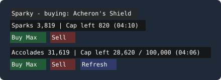

# Sparky

A [Windower 4](https://www.windower.net/) addon for Final Fantasy XI that automates buying and selling with **Sparks of Eminence** and **Unity Accolades**, and shows your balances and **weekly spending caps** in an on-screen HUD.

Sparky is based on the original Sparky addon by Byrth, extended with Prize Powder buying, weekly cap detection and the HUD.

*(Mockup of the HUD layout, not an in-game screenshot.)*

## Features

- **Sparks buying** from the sparks NPCs (Eternal Flame, Rolandienne, Isakoth, Fhelm Jobeizat) for a built-in list of items, Acheron's Shield by default.
- **Selling** of the selected item, or a bulk "purge" of a list of junk items.
- **Prize Powder buying** from the Unity NPC with Unity Accolades.
- **Weekly cap aware.** Buys are automatically reduced so they never exceed your remaining weekly cap:
  - Sparks cap is read from the sparks NPC menu.
  - Accolades cap (100,000 per week) is read at the Unity quantity prompt.
- **HUD** with your sparks and accolades, remaining caps and one-click buy / sell buttons.

## Installation

1. Copy `sparky.lua` into `Windower4/addons/sparky/`.
2. In game, run `//lua load sparky` (or add `lua load sparky` to your init script).

## HUD

The HUD loads with the addon. Drag it by the title bar. Its position is saved when the addon unloads.

| Row | Shows | Buttons |
|---|---|---|
| Title | The item the sparks buy button purchases | Drag handle |
| Sparks | Your sparks, remaining weekly cap, time the cap was last read | **Buy Max**, **Sell** |
| Accolades | Your accolades, remaining weekly cap / 100,000, time the cap was last read | **Buy Max**, **Sell**, **Refresh** |

- Sparks **Buy Max** / **Sell** run `//sparky buy` / `//sparky sell` for the currently selected item.
- Accolades **Buy Max** runs `//sparky powder max`. **Sell** sells all Prize Powder. **Refresh** reads the current accolades cap without buying anything.
- The buttons have the same requirements as the commands: stand near the NPC to buy, and have the vendor's shop menu open to sell.

**When the numbers update**

- The sparks cap updates every time a sparks NPC menu opens, and drops by an estimate after each purchase.
- The accolades cap is only sent by the game at the quantity prompt. It updates after a Unity purchase or when you press **Refresh**. The weekly reset can make an old value stale, so check the time stamp.
- A `?` means the value has not been seen yet this session.

## Commands

Use `//sparky <command>`.

| Command | What it does |
|---|---|
| `buy [n]` | Buy the selected item from a nearby sparks NPC, as many as your sparks, weekly cap and inventory allow (or up to `n`). |
| `sell [n]` | Sell the selected item from your inventory (or up to `n`). The vendor's shop menu must be open. |
| `item <name or id>` | Choose the item used by `buy` and `sell`. |
| `purge` | Sell every item on the built-in purge list. |
| `powder <count\|max>` | Buy Prize Powder from the Unity NPC with accolades. Limited by inventory space, accolades and the weekly cap. |
| `powder peek` | Read the accolades weekly cap without buying (used by the HUD's Refresh button). |
| `sellpowder` | Sell all Prize Powder in your inventory. The vendor's shop menu must be open. |
| `hud` | Show or hide the HUD. |
| `hud reset` | Move the HUD back to its default position. |
| `hud sparkscap <n>` | Set your total weekly sparks cap so the HUD shows "left / total". |
| `powder debug` | Log the Unity menu packets to `powder_debug.txt`. |
| `log` | Start / stop logging sparks NPC packets to `sparks_debug.txt` (for development). |
| `print` | Toggle print mode. |

Prize Powder purchases need you to be standing idle within range of the Unity NPC in your current city (Southern San d'Oria, Bastok Markets, Windurst Woods or Western Adoulin).

## How the caps are found

Both caps come straight from the game's own packets:

- **Sparks:** parameter 5 of the sparks NPC menu packet (`0x034`) is the remaining weekly cap.
- **Accolades:** parameter 3 of the event-update packet (`0x05C`) sent at the Unity quantity prompt is the remaining weekly cap.

## Notes

- Use at your own risk. Automating purchases and sales may be against the game's terms of service.
- Back up your inventory plan before a large `purge`, since it sells every item on the list.

## Credits

Original Sparky addon by Byrth. Prize Powder buying, weekly cap handling and the HUD added later.

## License

See the `LICENSE` file.
